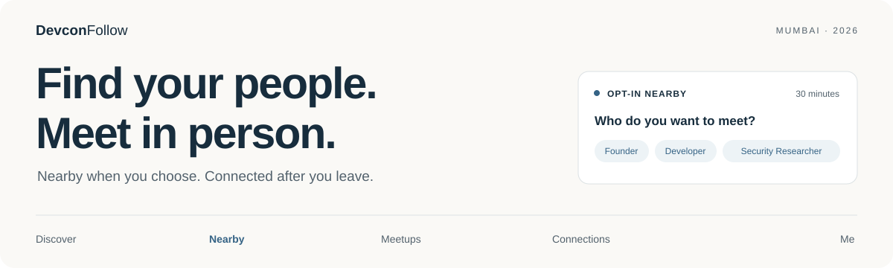

<p align="center">
  
</p>

<p align="center">
  <a href="https://devcon-follow.vercel.app/"><b>Open the web app</b></a> ·
  <a href="https://devcon-follow.vercel.app/install.html">Android installer</a> ·
  <a href="#how-to-use-it">How to use it</a> ·
  <a href="#run-locally">Run locally</a>
</p>

# Devcon Follow

**Find people worth meeting while they’re nearby and open to a conversation.**

Choose a role—Founder, Developer, Investor, Security Researcher or another role—and see relevant people who also opted into a **30-minute Nearby session** at your conference. Open a profile, request a meetup, and navigate to an agreed public meeting point. A person can separately approve a short-lived GPS request if they want to share their position with you.

After meeting, scan a profile QR, explicitly save the connection, and keep in touch after the event.

> **Current availability · 23 October 2026**
>
> Public web early access is open. Android **0.3.9/build 10** is signed and download-verified, but available only to approved testers. The independent native dependency audit still fails and physical phone acceptance is unverified. There is no TestFlight release. This is not a claim of a completed public native launch.

Devcon Follow is an independent community project. It is not affiliated with or endorsed by Devcon. Joining does not grant event admission or establish official ticket ownership.

## The experience

| Section | What you do |
| --- | --- |
| **Discover** | Find profiles by role, interests and whom someone wants to meet. Before arriving, browse only people who explicitly joined the event directory. |
| **Nearby** | Start a 30-minute session and filter opted-in people at your venue by role. See approximate GPS distance bands or supported native Bluetooth sightings. |
| **Meetups** | Send a reason, propose a time and choose a public landmark. Accept, decline, cancel or propose another time; export an accepted meeting to your calendar. |
| **Connections** | Save people explicitly, keep private notes and chat after mutual follows. Connections remain available after leaving. |
| **Me** | Edit your photo, roles, interests and social links. Manage visibility, profile QR and account controls. |

## How to use it

1. **Open [the web app](https://devcon-follow.vercel.app/).** Sign in with Google or email and complete any required email verification. No ticket number or invitation is required for basic community signup.
2. **Create your profile.** Add your role, interests and a clear goal, such as “I’m building developer tools and want to meet protocol founders.” Enable discoverability and the separate event-directory option if you want people to find you before arrival.
3. **Check in when you reach the venue.** Allow foreground location. The server checks your GPS accuracy, the configured venue boundary and the event time window. Opening Maps does not check you in.
4. **Choose Nearby → start a 30-minute session.** Select the role you want to meet. Others appear only while they also meet the access, venue, visibility and active-session requirements. Stop anytime; nothing renews automatically.
5. **Open a profile and make a plan.** Send a short reason for meeting, choose an available public meeting anchor and propose a time. Agree on the precise safe meeting spot in chat when needed.
6. **Use directions with consent.** Navigate to the agreed public landmark. To navigate toward a person’s shared GPS position, request their location and wait for their explicit approval. Indoor GPS can be inaccurate; this is not indoor turn-by-turn positioning.
7. **Meet and stay connected.** A QR opens the person’s profile; it never follows them automatically. Choose Follow yourself. Mutual follows can chat, and your connection notes remain private.

An empty Nearby list means there are no matching eligible, opted-in people in the result. Profiles are never fabricated to fill the screen. Declared roles are profile information, not verified professional credentials.

## Does it work only at Devcon?

**Nearby is currently configured for the Devcon venue and event window. The rest of your account is not tied to staying there.**

| Feature | Away from the venue | At the venue during the event window |
| --- | --- | --- |
| Sign in, edit profile and social links | Yes | Yes |
| Browse explicitly opted-in event-directory profiles | Yes | Yes |
| Open a profile/QR, follow, private notes and mutual chat | Yes, subject to visibility and access rules | Yes |
| Nearby GPS/Bluetooth discovery | No | Requires check-in and a separate 30-minute opt-in |
| Landmark meetups and requests for someone’s GPS position | No | Requires on-site access; GPS sharing also needs recipient approval |

### Configured event

**Devcon 8 India · Jio World Centre, BKC, Mumbai**

3 November 2026, **09:30 IST** → 6 November 2026, **17:00 IST**. [Official event details](https://tickets.devcon.org/) · [Travel guide](https://devcon.org/en/travel-guide/).

The community app uses an owner-approved **250 m boundary** around the published venue location. It is not proof of ticket ownership, an official venue perimeter, or permission to enter or remain overnight. Local admission rules, opening hours and staff instructions always apply.

The configured community meeting anchor is **Dhirubhai Ambani Square · south edge (agree spot in chat)**. Its approximate public-area pin is based on the [venue owner’s description](https://www.reliancefoundation.org/media/media-release/smt-nita-ambani-dedicates-dhirubhai-ambani-square) and [OpenStreetMap contributors’ geometry](https://www.openstreetmap.org/way/1159113174). It is not a confirmed entrance, exact standing position or official Devcon gathering. Agree on a safe pedestrian meeting spot and check access on arrival.

Other events are not enabled automatically. They need their own app-approved venue, dates and suitable public meeting points.

## Android, iPhone and the web

| Platform | Availability |
| --- | --- |
| **Web** | [Open now](https://devcon-follow.vercel.app/). Public verified-email signup; foreground GPS fallback. Browser Bluetooth attendee discovery is not offered. |
| **Android** | [Installer](https://devcon-follow.vercel.app/install.html) for approved testers. Signed standalone 0.3.9/build 10; no Expo Go required. Package minimum SDK 24, target SDK 36. These are build facts, not a real-device compatibility certification. |
| **iPhone** | Use the web app. iOS simulator compilation passes; there is no signed TestFlight/device release and no Apple Developer membership. |

For an approved Android tester: open the installer on your phone, sign in, download the verified APK and confirm installation. Android may ask you to allow installation from that browser; review the app and turn that permission off afterward. Open Devcon Follow and sign in inside the app. A successful download does not itself verify phone GPS, Bluetooth, camera or push behavior.

## Location and privacy

- **An explicit 30-minute choice.** The server enforces expiry. No silent renewal; native discovery operates in the foreground.
- **No public attendee coordinates.** Nearby returns uncertainty-aware GPS distance bands. Bluetooth indicates a compatible radio sighting; it cannot provide exact metres, bearings or walking directions.
- **Individual location approval.** Exact GPS access is a separate, temporary grant to a particular requester. A meetup invitation or follow is not location consent.
- **Stop revokes sharing.** Samples, active location grants and radio tokens are revoked. Server expiry still applies if a client goes offline.
- **No movement history.** The service keeps a latest temporary GPS sample: 75-second freshness, with venue presence refreshed within two minutes.
- **Private relationships.** Messaging requires mutual follows; notes are visible only to their author. Block, report, hide-profile and account-deletion controls are enforced server-side.

Internet/Wi-Fi/mobile data synchronize the app. Cross-platform Wi-Fi Direct discovery is not implemented or advertised. [Privacy notice](https://devcon-follow.vercel.app/privacy.html).

## What has been verified

| Check | Recorded result |
| --- | --- |
| API and integration tests | **122/122 PASS**, zero failures/skips, disposable MongoDB and independently signed sandbox identities |
| Two-account browser journeys | **PASS** — both public-community and invitation policies, role filtering, GPS consent/directions/revocation, meetups, QR follow, notes/chat and departure retention |
| Accessibility and reliability | **PASS** — five-screen axe checks, keyboard radio selection, 200% text, narrow layouts, refresh-token note drafts, offline Stop and recovery |
| Web build / native TypeScript / Android and iOS JS exports | **PASS** |
| Android and iOS simulator compilation | **PASS** for the signed candidate’s source |
| Android 0.3.9 signed artifact | **PASS** — signature, package, matching embedded bundle/map, 16 KB packaging checks and actual owner download checksum |
| API/database and place configuration | **PASS** — `/health/ready` and `/health/release`; the latter covers service configuration only |
| Native dependency audit | **FAIL** — 15 propagated high findings from the documented braces/node-forge advisories; gate remains visible |
| Physical phone installation and GPS/Bluetooth interoperability | **UNVERIFIED** |

Software tests, static packaging checks and a healthy service do not certify radio interoperability or a finished public native release. Official ticket verification is not connected. [Exact artifacts, hashes, CI links and remaining limits](docs/ANDROID_039_DELIVERY_2026-10-23.md).

## Run locally

Use **Node 24** and the committed lockfiles.

```sh
npm ci
npm --prefix web ci
npm --prefix mobile ci
npm run check
npm test
npm run build:web
npm --prefix mobile run typecheck
npx playwright install chromium
npm run test:browser
node scripts/browser-journey.mjs --community
npm run test:browser:reliability
npm run test:browser:parity
```

Tests use a disposable MongoDB and a loopback OIDC issuer, never Atlas or production attendee records. The first run may download a MongoDB binary. Set `CHROME_PATH` to use an existing compatible Chrome/Chromium executable.

For native packaging:

```sh
cd mobile
npx expo install --check
npx expo-doctor
npx expo export --platform android --platform ios
```

For a local app server, provision your own MongoDB and real OIDC clients, configure values described in [`.env.example`](.env.example), build the web app, then run:

```sh
node --env-file=.env src/server.js
```

Node does not load `.env` automatically. Keep credentials out of Git, URLs, logs and browser bundles. Web and native use separate OIDC public clients, authorization code + PKCE, verified emails and server-side token validation. Native refresh credentials belong in secure device storage. Callback examples: `https://YOUR_ORIGIN/` and `devconfollow://callback`.

## Architecture and operations

| Layer | Source |
| --- | --- |
| Web / PWA | [`web/`](web/) — React and Vite |
| API | [`src/`](src/) — Fastify, MongoDB and Socket.IO |
| Native | [`mobile/`](mobile/) — Expo/React Native, Android Kotlin and iOS Swift Bluetooth modules |
| Container | [`Dockerfile`](Dockerfile) — same-origin web and API |

The current website is on the existing Devcon Follow Vercel project. The API runs on its dedicated GCE VM with a reserved outbound IP restricted in the existing Atlas allowlist. Previous Railway reports are historical; use the current handoff. Existing Proof of Audits services and resources remain separate.

Health endpoints have distinct meanings: `/health/live` checks the process, `/health/ready` checks database readiness, and `/health/release` checks authentication, community access, administrator, venue and landmark configuration. Startup serves 503 for protected routes until the database is ready. A 200 response does not override the native security or physical-device gates.

Public community signup is separate from invitation-only policies and Android tester authorization. Revoked access is not restored by signing in again. Only an organizer-authorized read-only verifier may grant official ticket status; screenshots, ticket numbers and QR codes alone are insufficient. The app never redeems event check-in codes.

- [Current operator handoff](WORK_HANDOFF.md)
- [Operations, permissions and recovery](docs/OPERATIONS.md)
- [Current signed Android delivery](docs/ANDROID_039_DELIVERY_2026-10-23.md)
- [Product scope and ticket verification](docs/PRODUCT-SCOPE-AND-TICKET-VERIFICATION.md)
- [Native proximity design and limits](docs/NATIVE_PROXIMITY.md)

Older evidence documents describe their own source snapshots. The current handoff and linked delivery report take precedence for deployment and release status.
