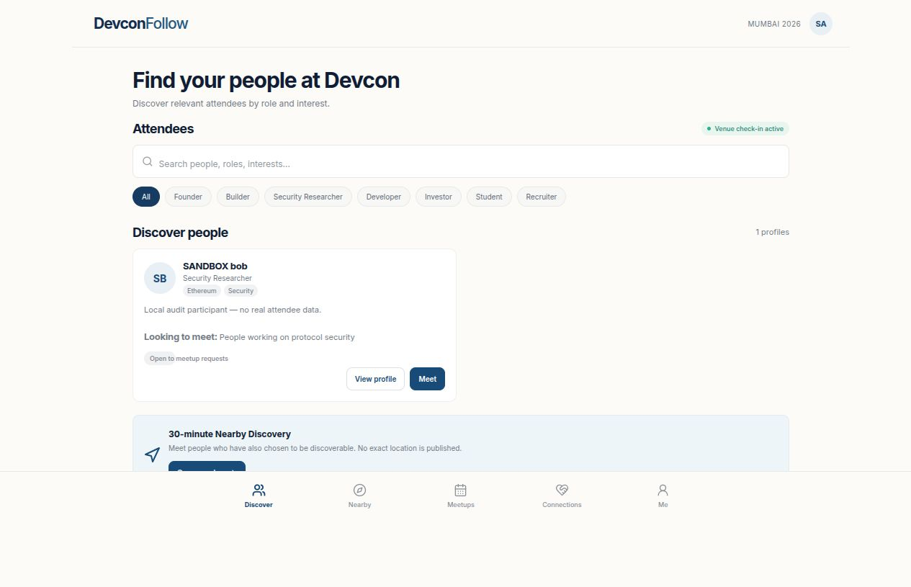
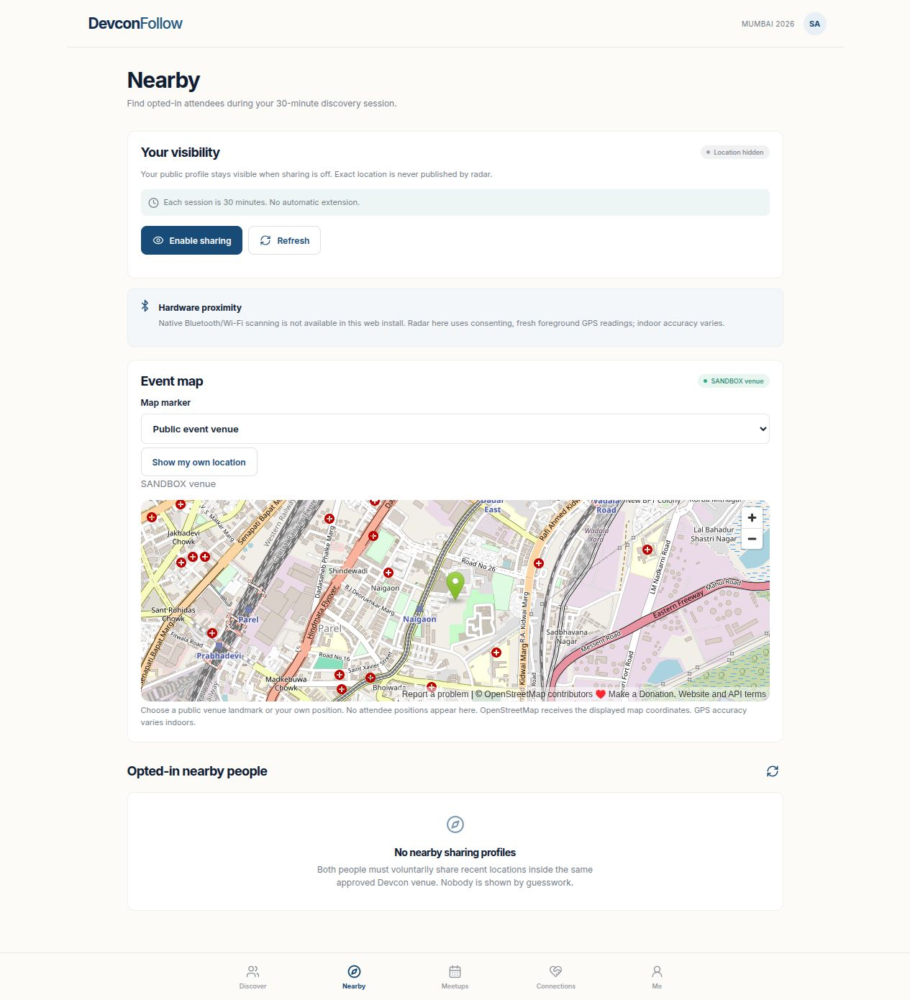
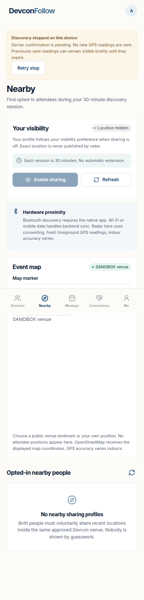
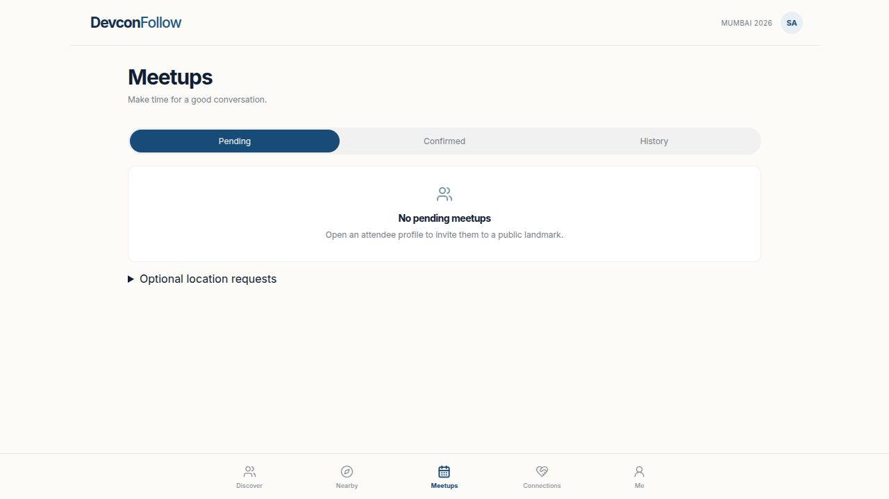
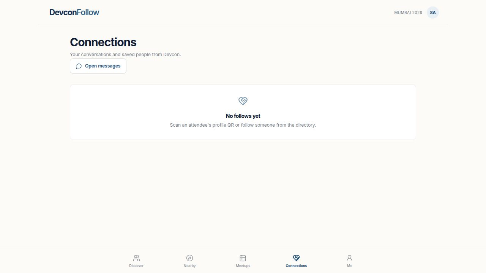
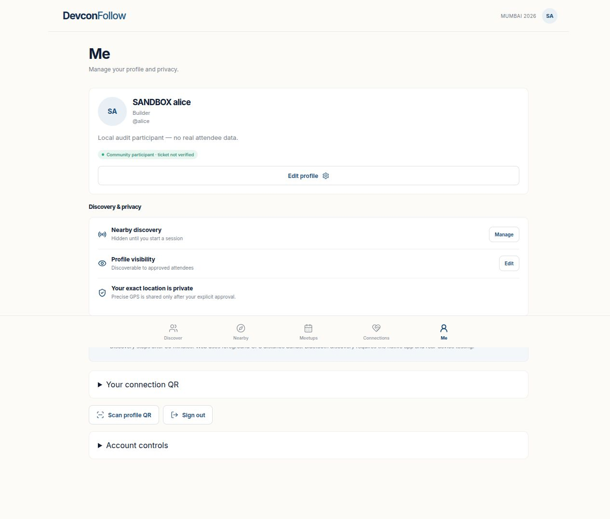

# Five-screen reliability audit — 19 October 2026

Scope: the existing Devcon Follow v1, reviewed in the in-app browser against a
loopback Fastify app, disposable MongoDB and sandbox OIDC issuer. Screenshots below
were captured and opened during this audit before source changes. No production
or staging attendee account/data was accessed. Synthetic participants are labeled
SANDBOX. These screenshots are evidence of the reviewed states, not evidence of
phone rendering or real proximity.

The modern layout, blue/paper palette and five-section navigation were retained.
Native claims below distinguish source review/compilation from physical UI tests.

## 1. Discover — usable; recovery and accessibility repaired

Observed: role chips, search, attendee goals, explicit profile and Meet actions
are clear. A search with no matches previously left only an empty result area.
Added a named no-matches state and Clear filters, selected state on role chips,
current-page navigation semantics, a visible search focus outline and larger
coarse-pointer targets. Native supports text search including roles/goals; it does
not yet expose the web role-chip filter. Both search the returned directory,
currently capped at 100; large-event pagination remains a known limitation.

## 2. Nearby — consent clear; Stop failure handling repaired

Observed: explicit sharing control and conservative privacy copy, with a public
venue/landmark map. Corrected the unconditional claim that one's profile stays
visible while GPS is off: visibility actually follows the profile preference.
Removed ambiguous Wi-Fi-scanning wording. Map attribution: © OpenStreetMap
contributors; coordinates in this fixture are synthetic audit geometry.

Web Stop previously depended on a successful network DELETE before local state
changed. It now immediately pauses GPS writes, shows pending server confirmation,
blocks a new session, persists the pending stop per identity across reloads and
retries when connectivity returns. Other tabs receive a stop flag through browser
storage events. Pending stop never extends a session. Already sent readings can
remain available until their bounded expiry if the server cannot be reached.
If browser persistent storage is unavailable, the in-memory pause still works,
but durable cross-reload/cross-tab behavior cannot be guaranteed; browser storage
failure is a known limitation, not a reason to claim server revocation offline.

The recovery screenshot uses a simulated failed DELETE and browser time
advancement; the external map frame was not loaded in that capture. It is not
evidence of map-provider availability.

Native Stop already clears radio state and nearby lists before the server request.
Native foreground/background, expiry and GPS-only paths were source reviewed;
actual Bluetooth and OS permission/lifecycle behavior remains unverified on phones.

## 3. Meetups — web structure clear; native parity improved

Observed: Pending/Confirmed/History and a separate collapsed optional GPS section
avoid confusing public-landmark invitations with exact-location access. Native
now has matching list categories. Both clients hide Accept/Decline/Cancel actions
once the proposed meeting time has passed, show loading separately from empty
results, and offer retry after list errors. The API still checks recipient,
current venue, status and meeting time; UI filtering is not authorization.
Meeting records expire 30 minutes after their start, so History is transient,
not a permanent conference diary. This retention behavior was preserved.

## 4. Connections — navigation and unfollow gap repaired

Observed: a clear empty state and message entry point. Saved profiles previously
had no web Unfollow action, while native did. Added web Unfollow, which removes
the follow and its private note through the existing API. Returning from a saved
profile goes back to Connections instead of always jumping to Discover. Web and
native note-load failures now expose Retry while keeping Save disabled until the
existing note has loaded. A failed load cannot silently erase an existing note.

## 5. Me — privacy controls retained; native accessibility improved

Observed: separate community badge, profile visibility, timed sharing, QR and
account controls. Native shared buttons now declare button role/disabled state;
handle input avoids automatic capitalization; zero-metre GPS accuracy is accepted
as a valid numeric reading. Logout also clears camera-scanning/ticket-input state.
Calculated muted-text contrast improved from 4.28:1 to 5.93:1 on white
(5.73:1 on the paper background); updated green/gray badge pairs exceed 5.7:1.
These are selected CSS color checks, not full accessibility certification.
Web badges were enlarged and touch
targets improved without changing the visual direction.

## Verified parity and limits

| Capability | Web evidence | Native evidence / limit |
| --- | --- | --- |
| Login/community/profile/goals/visibility | Local PKCE journey and API tests | Source review, TypeScript, Hermes exports and CI compile; real provider/phone UI pending |
| Directory and goal search | Local browser interactions | Source review + compilation; no role chips or large-event pagination |
| 30-minute Nearby/Stop/GPS fallback | API expiry/race tests; browser denied permission, offline Stop/reload/reconnect | Source and compile checks; BLE/permissions on phones blocked |
| Reason/landmark/meeting decision/cancel | Browser acceptance and API cancellation/privacy tests | Source and compile checks; Pending/Confirmed/History implemented |
| QR opens profile before explicit follow | Browser QR-link route + no implicit follow assertion | Camera code reviewed/compiled; physical scan and camera denial UI need device checks |
| Notes/unfollow/mutual chat after leaving | Browser + disposable Mongo privacy tests | Source review/compile; UI/device persistence not independently exercised |
| Block/revoke/account deletion | Disposable Mongo + signed-identity negative tests | API shared; native invocation reviewed, phone interaction pending |

Known gaps: native lacks photo/social-link editing and the web paste-a-profile-link
QR fallback; it preserves existing photo/social data. Browser note editors can
reset an unsaved draft when the authenticated API callback changes after token
renewal. Full screen-reader, Dynamic Type, contrast coverage, camera and hardware
permission testing has not run. No WCAG compliance or complete native UI parity
is claimed from screenshots or successful compilation.

Reproduction: `npm run test:browser`, `npm run test:browser:reliability`, `npm test`,
`npm --prefix mobile run typecheck`. Browser-reliability includes permission denial,
failed note load/retry, explicit follow, private-note isolation, unfollow cleanup,
back navigation, offline Stop, reload and reconnect. Evidence is saved under
`artifacts/browser/` and `artifacts/browser-reliability/` and uploaded by CI.
See PILOT_ACCEPTANCE_CHECKLIST.md for owner authorization and phone requirements.
